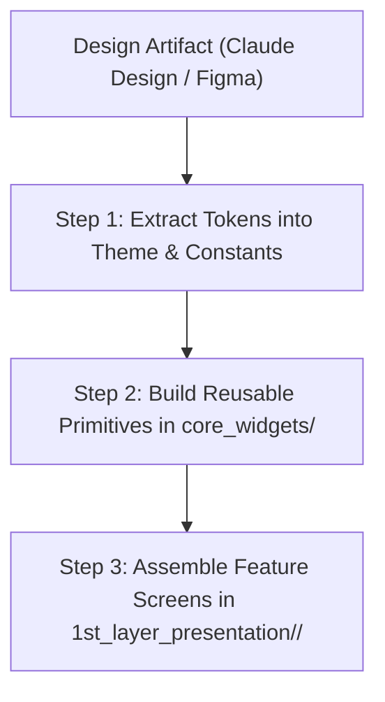

# Design System & Handoff Guide

This directory is the entry point for turning UI designs into code. When building a new application from this template, link or place your design specification here, then follow the mandatory theme mapping contract before writing presentation widgets.

---

## 1. Design Source / Handoff Slot

<!-- 
PASTE YOUR DESIGN SPECIFICATION BELOW:
- Claude Design Artifact URL or export
- Figma / Sketch / Penpot design link
- Design token export or wireframe bundle
-->

- **Design System URL:** *(Paste Claude Design or Figma link here)*
- **Status:** Pending handoff
- **Notes:** *(Add any product-specific visual guidelines or brand constraints)*

---

## 2. Mandatory Flutter Theme Mapping Contract (AI Workflow)

When an AI agent or developer translates design artifacts into code, they must follow this 3-step contract in exact order. Skipping step 1 and hardcoding visual tokens directly into screens is blocked by `architecture_checker.dart`.

### Step 1: Extract Design Tokens First
Before building any screen or widget, map every design token into the centralized app configuration:

1. **Colors & Elevation:**
   - Define semantic colors in `lib/core/extensions/theme_extensions.dart` inside `ColorPalette` (implementing both Light and Dark variants).
   - Define elevation levels and box shadows in `ShadowPalette` (both Light and Dark variants).
   - Register them in `lib/app_theme.dart`.
2. **Typography:**
   - Add font files to `assets/fonts/` and register them in `pubspec.yaml` with explicit numeric `weight:` declarations (e.g. `weight: 400`, `weight: 500`, `weight: 600`, `weight: 700`).
   - Configure the text styles in `AppTheme.textTheme`.
3. **Spacing, Radii, and Sizing:**
   - Add all margins, paddings, corner radii, and standard icon/button dimensions to `lib/app_constants.dart` using `SCREAMING_SNAKE_CASE` constants.

### Step 2: Build Reusable Primitives in `core_widgets/`
- Build shared buttons, cards, text fields, dialogs, and loaders under `lib/1st_layer_presentation/core_widgets/`.
- Every primitive must accept theme tokens or read from `context.colorPalette` / `context.textTheme` / `AppConstants`.
- Provide interactive `Key('<element>')` anchors and `Semantics` labels on interactive components.

### Step 3: Assemble Feature Screens
- Build feature screens under `lib/1st_layer_presentation/<feature>/`.
- Consume **only**:
  - `context.colorPalette` for colors
  - `context.shadowPalette` for elevations
  - `context.textTheme` for typography
  - `AppConstants` for layout dimensions
  - `context.l10n` for all user-facing strings
- **Zero raw styling allowed:** Calling `Color(...)`, `Color.from*`, `Colors.*`, `CupertinoColors.*`, or `BoxShadow(...)` in feature presentation widgets is strictly prohibited.
