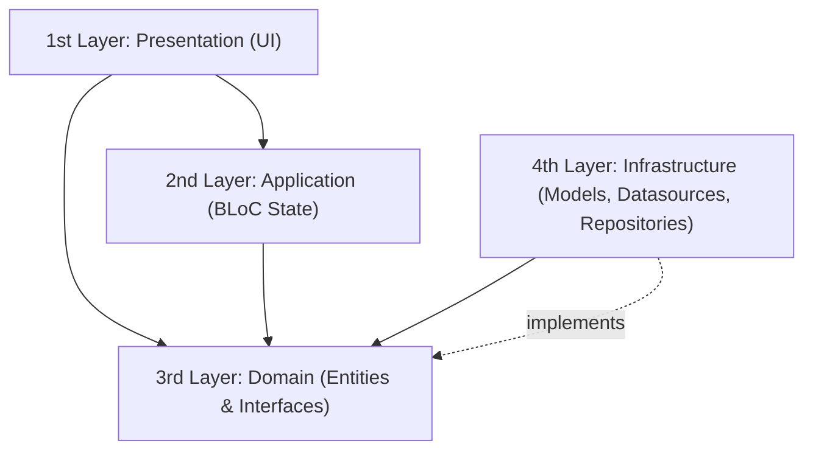

# Architecture Guide

This repository is built on a strict **4-Layer Clean Architecture** pattern. Dependencies flow strictly inward/downward: outer layers know inner layers, but inner layers never import or depend on outer layers.



## The 4 Clean Architecture Layers

### 1st Layer: Presentation (`lib/1st_layer_presentation/`)

- **Purpose:** Everything rendered on screen and user interaction. Triggers BLoC events and rebuilds UI based on BLoC states (`BlocBuilder`, `BlocConsumer`, `BlocListener`).
- **Folder Structure:**
  - Feature directories: `home/`, `page_2/`, `page_3/`, `page_4/`, `error_screen/`. Each feature contains the screen widget (e.g., `home_page.dart`) and an optional `widgets/` subdirectory for feature-private widgets.
  - `application_scaffold/`: Top-level navigation container hosting the `BottomNavigationBar` and managing tab switching via `StatefulShellRoute`.
  - `core_widgets/`: Reusable, app-wide UI components (buttons, dialogs, bottom sheets, indicators). *(Note: folder name is `core_widgets/` without any file extension).*
- **Rules & Restrictions:**
  - **No Infrastructure or Network imports:** Must never import `4th_layer_infrastructure/` or `package:dio`.
  - **No raw color or shadow constructors:** Constructing `Color(...)`, `Color.fromARGB(...)`, or `BoxShadow(...)`, as well as referencing `Colors.*` or `CupertinoColors.*`, is strictly prohibited in presentation widgets. All styling must consume:
    - `context.colorPalette` (semantic colors from `ColorPalette`)
    - `context.shadowPalette` (semantic elevation from `ShadowPalette`)
    - `context.textTheme` (typography tokens)
    - `AppConstants` (`SCREAMING_SNAKE_CASE` spacing, sizing, and corner radii)
  - **No hardcoded text:** All UI copy must be retrieved via `context.l10n.<stringKey>`.
  - **Direct inline context extensions:** Widgets must call `context.colorPalette.*`, `context.shadowPalette.*`, `context.textTheme.*`, and `context.l10n.*` **directly inline** inside `build()` rather than caching local alias variables (`final colorPalette = context.colorPalette;`, `final l10n = context.l10n;`, `final themeData = context.theme;`).
  - **Testability Keys:** The root widget of every screen must specify `Key('<screen>_page')` (e.g. `Key('home_page')`). Interactive controls (buttons, inputs, navigation tabs) must specify `Key('<screen>_<element>')` (e.g. `Key('nav_tab_page_2')`).

### 2nd Layer: Application (`lib/2nd_layer_application/`)

- **Purpose:** Pure state orchestration using `flutter_bloc`. BLoCs coordinate user intent, call domain repository interfaces, and emit immutable states.
- **Organization & Distinction:**
  - `2nd_layer_application/application/`: Reserved exclusively for app-wide lifecycle BLoCs that govern global app state, such as `ThemeBloc` and `LocaleBloc`.
  - `2nd_layer_application/<feature>/`: Feature-specific BLoCs scoped to individual workflows or business domains (e.g. `auth_bloc/`, `cart_bloc/`).
- **Rules & Restrictions:**
  - **Free of UI dependencies:** Must never import `package:flutter/material.dart`, `package:flutter/cupertino.dart`, or `package:flutter/widgets.dart`. (If a BLoC requires `Locale`, import `dart:ui` and `package:meta/meta.dart`).
  - **No outer layer imports:** Must never import `1st_layer_presentation/`, `4th_layer_infrastructure/`, or `package:dio`. Interacts solely with `3rd_layer_domain/`.
  - **BLoC Structure:**
    - Events are `sealed class <Name>Event` with immutable subclasses.
    - States are immutable subclasses of `Equatable` for value equality without rebuild boilerplate.
    - When a BLoC constructor dispatches an initial loading event (e.g. `ThemeEventLoadSettings`), use a sequential transformer `transformer: (events, mapper) => events.asyncExpand(mapper)` to guarantee sequential execution without race conditions against subsequent user actions.
    - State persistence must always be awaited before emitting the new state.

### 3rd Layer: Domain (`lib/3rd_layer_domain/`)

- **Purpose:** The pure core of the application containing business rules, enterprise entities, and contract interfaces.
- **Folder Structure:**
  - `entities/`: Pure Dart data structures extending `Equatable`.
  - `interfaces_repositories/`: Abstract repository contracts defining data operations (`abstract interface class Interface<Feature>Repository`).
  - `interfaces_local_datasources/`: Abstract storage contracts (`abstract interface class Interface<Feature>LocalDatasource`).
- **Rules & Restrictions:**
  - **100% Pure Dart:** Must have zero dependencies on Flutter (`flutter/*`), HTTP clients (`dio`), routing (`go_router`), local persistence (`shared_preferences`), or any other layer.
  - Contracts use `abstract interface class` definitions so they can only be implemented, never extended or instantiated.

### 4th Layer: Infrastructure (`lib/4th_layer_infrastructure/`)

- **Purpose:** Implementation of the contracts declared in `3rd_layer_domain/`. Handles network communication, database operations, device storage, and JSON serialization.
- **Folder Structure:**
  - `models/`: Data Transfer Objects (DTOs) with `fromJson`, `toJson`, and `.toDomain()` mapping to convert to domain entities.
  - `repositories/`: Concrete implementations of `Interface<Feature>Repository`. They invoke datasources, map DTOs to domain entities, catch transport/storage exceptions, and rethrow structured domain/app exceptions.
  - `local_datasources/` & `remote_datasources/`: Direct access to `SharedPreferencesAsync`, databases, or network APIs.
- **Networking & API Protocol:**
  - **`ApiClient` is mandatory:** All network requests must use the injected `ApiClient` (`lib/core/network/api_client.dart`). Direct instantiation of `Dio()` is strictly forbidden outside `api_client.dart`.
  - Logging is handled automatically by `ApiClient`'s interceptors. Repositories should only log unexpected failure boundaries via `sl<Logger>()`.
  - Transport errors are caught by `ApiClient` and converted into `ApiException` with typed `ApiErrorType`.
  - Unexpected or unhandled errors are mapped to `ExceptionUnknown`.
- **`strict-inference`-valid API parsing pattern:**

```dart
final response = await _apiClient.get<List<dynamic>>('/items');
final rawList = response.data ?? const <dynamic>[];
return rawList
    .map((json) => ExampleItemModel.fromJson(json as Map<String, dynamic>).toDomain())
    .toList();
```

## Cross-Cutting Core (`lib/core/`)

- **Purpose:** Centralized repository for feature-agnostic utilities, technical infrastructure abstractions, and framework extensions shared across layers. Houses zero business domain logic.
- **Folder Structure:**
  - `network/`: Central `ApiClient` encapsulating `Dio`, automatic base URL configuration, request/response logging, standard headers, and timeouts.
  - `exceptions/`: Low-level technical and transport exceptions (`ApiException`, `ApiErrorType`, `ExceptionUnknown`) thrown by datasources or clients before mapping to domain failures.
  - `extensions/`: Ergonomic extensions on framework and language types:
    - `BuildContext`: Direct inline access to design tokens (`context.colorPalette`, `context.shadowPalette`, `context.textTheme`), window metrics (`context.sizeOf`, `context.paddingOf`), and localization (`context.l10n`).
    - `ThemeExtension`: Strongly-typed `ColorPalette` and `ShadowPalette` models (`lib/core/extensions/theme_extensions.dart`). Adapt these palettes with the semantic design tokens needed for the app's design system while strictly preserving the class structure (`copyWith` and `lerp`).
    - Primitives: Numeric layout spacers (`.heightSizedBox`, `.widthSizedBox`) and string utilities.
  - `enums/`: Shared technical, presentation, or layout enums that span multiple features.
- **Rules & Restrictions:**
  - **No Feature Dependencies:** Must never import feature-specific code (`lib/1st_layer_presentation/<feature>/`, `lib/2nd_layer_application/<feature>/`).
  - **Dio Encapsulation:** Direct instantiation of `Dio()` is strictly forbidden outside `lib/core/network/api_client.dart` (enforced by `architecture_checker.dart`).
  - **Domain Pure-Dart Boundary:** `3rd_layer_domain/` must remain 100% pure Dart and must never import Flutter-dependent core files (`build_context_extensions.dart`, `theme_extensions.dart`).

## App-Level Wiring (`lib/app_*.dart`)

The root `lib/` folder contains centralized configuration files wiring the application together:

| File | Responsibility |
| --- | --- |
| `app_environment.dart` | Compile-time environment configuration (`--dart-define=ENVIRONMENT=dev\|staging\|prod`). Defines base API URLs and environment flags. |
| `app_settings.dart` | Early app initialization. Ensures `WidgetsFlutterBinding.ensureInitialized()` and loads core settings before app startup. |
| `app_dependency_injection.dart` | Service locator setup using `GetIt` (`sl`). Registers singletons, datasources, repositories, and BLoCs. Manages the instance-scoped `AppRouter` with `dispose: (r) => r.router.dispose()`. |
| `app_bloc_provider.dart` | Global BLoC provision for `MultiBlocProvider`. Requires **mandatory explicit type argument** on every item: `List<BlocProvider<StateStreamableSource<Object?>>> get allBlocProviders => [BlocProvider<ThemeBloc>(...), BlocProvider<LocaleBloc>(...)];`. |
| `app_router.dart` | Declarative routing configuration via `GoRouter` and `StatefulShellRoute.indexedStack`. Keeps individual tab navigation stacks alive. |
| `app_theme.dart` | Central light and dark theme definitions consuming `ColorPalette` and `ShadowPalette`. Adapt token values to the app's design while preserving structure. |
| `app_constants.dart` | `SCREAMING_SNAKE_CASE` layout tokens: paddings, corner radii, icon sizes, and component dimensions. No magic numbers in UI code. |
| `app_bloc_observer.dart` | Central BLoC transition and error observer logging lifecycle events via `Logger`. |

## Localization (`lib/l10n/`)

- Localization is managed via standard Flutter ARB files located in `lib/l10n/`:
  - `app_en.arb` (English default template)
  - `app_de.arb` (German translations)
- Run `flutter gen-l10n` to update generated classes in `lib/l10n/app_localizations.dart`.
- Access translations in widgets directly inline through the extension `context.l10n.<key>`.
- Never hardcode user-facing strings or fallback text in widgets.

## UI Testability & Key Anchors

To ensure fast, reliable, headless testing without flaky text finders or simulator dependencies:
1. **Screen Root Keys:** Every page root container must have a key: `Key('<screen>_page')` (e.g. `Key('home_page')`, `Key('page_2_page')`).
2. **Interactive Element Keys:** Every button, tab, text field, or list item without an unambiguous unique semantics identifier must have a key: `Key('<screen>_<element>')` (e.g. `Key('nav_tab_page_2')`, `Key('home_toggle_theme_btn')`).
3. **Accessibility:** Use `Semantics(label: ...)` for controls where screen readers benefit from descriptive text, allowing test finders to query via `find.bySemanticsLabel(...)`.
4. **Layout-Free Finders:** Tests must never find widgets by layout primitives (`Padding`, `Container`, `SizedBox`, `Column`, `Row`).
